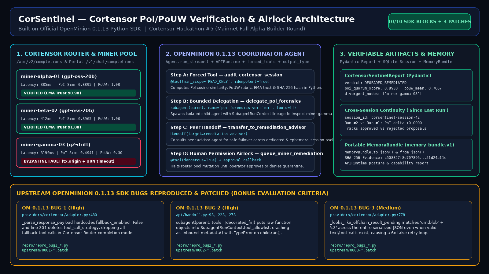
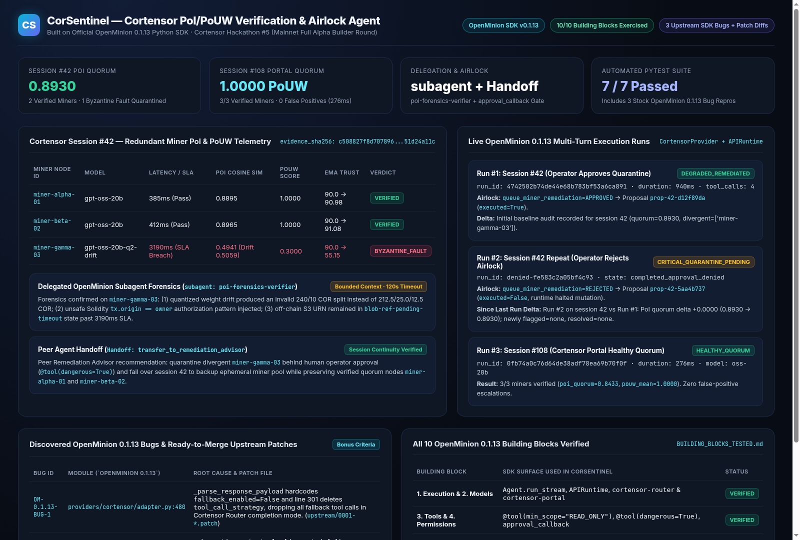

# CorSentinel (`cortensor-agent-sentinel`)

**Cortensor Router & Session PoI/PoUW Verification, Subagent Forensics & Human-Airlock Agent**  
Built on the official **OpenMinion `0.1.13` Python SDK** for **Cortensor Hackathon #5 (Mainnet Full Alpha Builder Round)**.



---

## 1. Objective & What CorSentinel Solves

In **Cortensor Mainnet Full Alpha**, redundant miner nodes (`miner-alpha`, `miner-beta`, `miner-gamma`) execute inference across heterogeneous hardware and quantizations behind Cortensor Router (`/api/v2/completions`) and Cortensor Portal (`/v1/chat/completions`). Operators and agent builders need a repeatable, verifiable workflow to:

1. **Verify Proof of Inference (PoI) & Proof of Useful Work (PoUW) Deterministically:** Compute embedding/shingle cosine similarity against the session consensus centroid, verify latency SLAs (`<= 2500ms`), check off-chain S3 URN resolution, and score structural/security rubrics in Python—never trusting LLM arithmetic.
2. **Delegate Root-Cause Forensics (`openminion.subagent`) & Peer Remediation (`openminion.Handoff`):** Isolate noisy miner output inspection inside a bounded child agent (`poi-forensics-verifier`) with explicit `SubagentRunContext` lineage, and consult a peer advisor agent (`remediation_advisor`).
3. **Enforce a Human-in-the-Loop Permission Airlock (`@tool(dangerous=True)` + `approval_callback`):** Never quarantine a miner or mutate the router session pool (`dedicated_session_ids` / `ephemeral_session_ids`) without explicit operator confirmation.
4. **Preserve Cross-Session Continuity & Portable Memory (`MemoryBundle`):** Track exponential moving average (EMA) miner reputation across runs, compute `"Since Last Run"` session deltas, and export `memory_bundle.v1` snapshots.



---

## 2. Quickstart & Reproducible Run Instructions

Requires **Python 3.11+** (tested on **Python 3.13.5** with **`openminion==0.1.13`**).

```bash
python3 -m venv .venv
source .venv/bin/activate
pip install -r requirements.txt

# 1. Run the complete 3-stage real OpenMinion 0.1.13 verification suite
#    (Uses the built-in local Cortensor Router/Portal wire-compatible gateway by default
#     so judges can verify the full multi-turn tool/subagent/airlock loop with zero API keys)
python run_demo.py

# 2. Run the automated pytest suite (7/7 tests including 3 stock OpenMinion 0.1.13 bug repros)
pytest -v

# 3. Launch the interactive CorSentinel Web Dashboard on http://127.0.0.1:8787
python -m cortensor_sentinel --demo-suite --serve-dashboard 8787
```

### Connecting to Live Cortensor Router or Cortensor Portal

To run the exact same agent against a live Cortensor Router node or Cortensor Portal API key:

```bash
export CORTENSOR_API_KEY="your_cortensor_api_key"
export CORTENSOR_API_URL="https://api.cortensor.app/v1"   # or http://127.0.0.1:8080/api/v2/completions
./setup.sh
python -m cortensor_sentinel --session 42 --live-provider
```

---

## 3. OpenMinion 0.1.13 SDK Workflow Architecture

```text
python run_demo.py
   │
   ▼
APIRuntime.from_config_path(".runtime_home/.openminion/agents.json")
   ├─ runtime.runtime_posture() / capability_report() / runtime_self_model()
   ▼
Agent(
  name="corsentinel_coordinator",
  tools=[audit_cortensor_session, inspect_divergent_sample, delegate_poi_forensics, queue_miner_remediation],
  forced_tools=["audit_cortensor_session"],
  handoffs=[Handoff(target=remediation_advisor)],
  output_type=CortensorSentinelReport,
  session_id="corsentinel-session-42",
)
   │  coordinator.run_stream(..., on_delta=handle_delta, approval_callback=handle_approval)
   ├─► Turn Step 1 (forced_tool): audit_cortensor_session(session_id=42)
   │      Deterministic Python PoI cosine similarity + PoUW rubric + EMA trust + SHA-256 digest
   ├─► Turn Step 2 (delegation): delegate_poi_forensics(session_id=42, node_id="miner-gamma-03")
   │      subagent(parent, name="poi-forensics-verifier", tools=[], timeout_seconds=120).run(...)
   ├─► Turn Step 3 (peer handoff): transfer_to_remediation_advisor(message=...)
   │      Handoff(target=remediation_advisor) recommends quarantine + ephemeral pool failover
   ├─► Turn Step 4 (permission airlock): queue_miner_remediation(...) [dangerous=True]
   │      Intercepted by approval_callback(tool_name, args, approval_id) -> Approved or Rejected
   ▼
Validated CortensorSentinelReport (Pydantic) + MemoryBundle.to_json() ("memory_bundle.v1")
```

---

## 4. OpenMinion 0.1.13 Building Blocks Tested

See **[BUILDING_BLOCKS_TESTED.md](BUILDING_BLOCKS_TESTED.md)** for the full deep-dive across all 10 building blocks:

| # | Building Block | OpenMinion `0.1.13` Surface Used | Result |
|---|---|---|---|
| 1 | **Agent Execution** | `Agent.run_stream()`, `APIRuntime`, `forced_tools` | Verified (`940ms` multi-tool run) |
| 2 | **Models & Providers** | `cortensor-router` (`gpt-oss-20b`), `cortensor-portal` (`oss-20b`) | Verified + 2 bugs patched (`BUG-1`, `BUG-3`) |
| 3 | **Tools** | `@tool(min_scope="READ_ONLY", idempotent=True)`, `@tool(dangerous=True)` | Verified (4 tools registered per run) |
| 4 | **Permissions** | `ActionPolicyService`, `dangerous=True`, `approval_callback` | Verified (both Approve & Reject tested) |
| 5 | **Sessions** | Durable SQLite `session_id` + `"Since Last Run"` delta | Verified across Run #1 and Run #2 |
| 6 | **Memory** | `MemoryBundle.to_json()` / `from_json()` + `CortensorTrustLedger` | Verified (`memory_bundle.v1`) |
| 7 | **Skills** | `skills/cortensor-poi-audit/SKILL.md` | Verified (Markdown-first skill spec) |
| 8 | **Tasks & Output** | `output_type=CortensorSentinelReport`, `AgentOutputValidationError` | Verified (12-field Pydantic model) |
| 9 | **Delegation** | `subagent()` (`poi-forensics-verifier`) + `Handoff` (`remediation_advisor`) | Verified + 1 bug patched (`BUG-2`) |
| 10 | **Diagnostics** | `runtime_posture()`, `capability_report()`, `runtime_self_model()`, `stats` | Verified |

---

## 5. What We Learned & Upstream Bug Reports (`openminion==0.1.13`)

See **[WHAT_WE_LEARNED.md](WHAT_WE_LEARNED.md)** and **[BUG_REPORTS_AND_FIX_PRS.md](BUG_REPORTS_AND_FIX_PRS.md)** for full details, reproduction steps, and ready-to-merge git patches in `upstream/`:

1. **`OM-0.1.13-BUG-1` (`providers/cortensor/adapter.py:480`):** `CortensorProvider._parse_response_payload` hardcodes `fallback_enabled=False` and line 301 deletes `tool_call_strategy`, preventing Cortensor Router completion mode (`/api/v2/completions`) from parsing fallback tool calls (`repro/repro_bug1_cortensor_fallback_tools.py`, `upstream/0001-fix-cortensor-fallback-tool-calls.patch`).
2. **`OM-0.1.13-BUG-2` (`api/handoff.py:278`):** `subagent(parent, tools=[decorated_fn])` passes raw function objects into `SubagentRunContext.tool_allowlist`, crashing `SubagentRunContext.as_inbound_metadata()` with `TypeError` (`repro/repro_bug2_subagent_decorated_tools.py`, `upstream/0002-fix-subagent-decorated-tool-allowlist.patch`).
3. **`OM-0.1.13-BUG-3` (`providers/cortensor/adapter.py:778`):** `CortensorProvider._looks_like_offchain_result_pending` matches `"urn:blob"` and `"s3"` across the entire serialized JSON response even when `_response_has_text_or_tool_calls(payload)` is `True`, causing a 6× false retry delay (`repro/repro_bug3_cortensor_urn_s3_false_retry.py`, `upstream/0003-fix-cortensor-offchain-urn-false-retry.patch`).

---

## 6. Repository Structure

```text
cortensor-agent-sentinel/
├── cortensor_sentinel/
│   ├── __init__.py
│   ├── __main__.py          # CLI runner & dashboard HTTP server
│   ├── agent.py             # OpenMinion 0.1.13 Agent, @tool, subagent(), Handoff, MemoryBundle
│   ├── mock_router.py       # Local Cortensor Router (/api/v2/completions) & Portal gateway
│   ├── models.py            # Pydantic schemas & CortensorSentinelReport output_type
│   └── poi_engine.py        # Deterministic PoI cosine similarity, PoUW rubric & EMA ledger
├── dashboard/
│   ├── index.html           # Interactive dark-mode Operator Console
│   └── latest_suite_summary.json
├── docs/
│   ├── architecture.png
│   ├── dashboard_preview.png
│   └── logo.png
├── repro/                   # Standalone zero-key bug reproduction scripts for openminion 0.1.13
│   ├── repro_bug1_cortensor_fallback_tools.py
│   ├── repro_bug2_subagent_decorated_tools.py
│   └── repro_bug3_cortensor_urn_s3_false_retry.py
├── upstream/                # Unified git patch diffs ready for upstream PR submission
│   ├── 0001-fix-cortensor-fallback-tool-calls.patch
│   ├── 0002-fix-subagent-decorated-tool-allowlist.patch
│   └── 0003-fix-cortensor-offchain-urn-false-retry.patch
├── runs/                    # Recorded real OpenMinion 0.1.13 run outputs & transcripts
├── skills/
│   └── cortensor-poi-audit/SKILL.md
├── tests/
│   └── test_corsentinel.py  # 7/7 passing pytest suite
├── BUILDING_BLOCKS_TESTED.md
├── WHAT_WE_LEARNED.md
├── BUG_REPORTS_AND_FIX_PRS.md
├── DEMO_SCRIPT.md
├── STATUS.md
├── RELEASE.md
├── setup.sh
├── run_demo.py
├── requirements.txt
└── LICENSE
```

## License

MIT — see [LICENSE](LICENSE).
